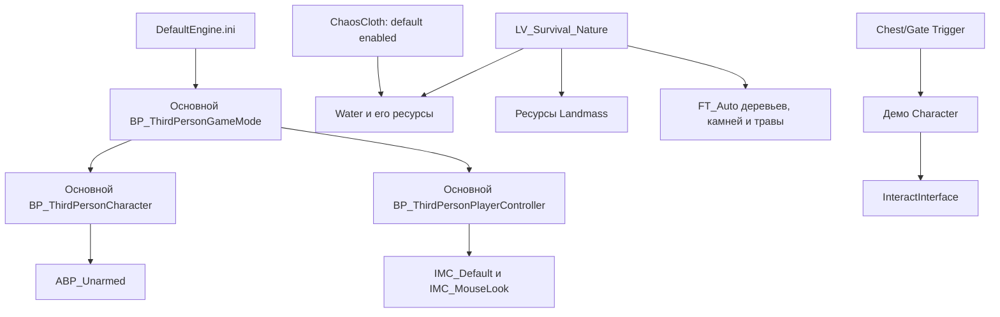

> Копия документа на 25.10.2026. Исторические статусы сохранены; актуальное состояние — [ProjectStatus.md](../ProjectStatus.md). Локальные пути обезличены; обозначения раскрыты в Docs/README.md.

# A01 — сверка проекта в Unreal Editor

Дата: 25.10.2026. Статус: **выполнена**. Проверен настоящий проект `<PROJECT_ROOT>\SurvivalProject.uproject` в UE **5.8.4-58902052**.

Этот отчёт уточняет первоначальный файловый аудит. При расхождении сведений использовать результаты A01. Следующие задачи ещё не выполнялись.

## 1. Что проверено

- Открытый редактор, текущая карта, World Settings и классы размещённых акторов.
- AssetRegistry: 772 записи `/Game`, включая внешние акторы; 47 прямых package dependencies рабочей карты.
- Графы всех 15 обычных Blueprints, 5 Animation Blueprints и 3 Widget Blueprints: 86 графов, 869 объектов узлов. Прочитаны пины K2-узлов, их значения и связи. Узлы анимационных состояний, комментарии и прочие не-K2 узлы представлены классом/именем/доступными диагностическими полями.
- Повторная компиляция этих 23 ресурсов в памяти редактора, без сохранения пакетов.
- Фактические GameMode, Controller, Pawn и PlayerState в PIE на рабочей карте.
- Зависимости рабочей карты и основного GameMode через Reference Viewer и экспорт AssetRegistry. Визуальный граф карты ограничен стандартной шириной 20; полный список из 47 прямых зависимостей взят из API, а не подсчитан по экрану.
- Дескрипторы Water, EnhancedInput, GameplayStateTree, StateTree и цепочка зависимости ChaosCloth→Water.

## 2. Активные классы и карта

World Settings `LV_Survival_Nature`: `default_game_mode=None`, `world_partition=None`, `enable_world_bounds_checks=True`. Карта использует глобальный GameMode из DefaultEngine.ini, собственного override нет.

PIE создал:

| Роль | Подтверждённый class path |
|---|---|
| Мир | `/Game/Content/Survival/Maps/UEDPIE_0_LV_Survival_Nature.LV_Survival_Nature` |
| GameMode | `/Game/ThirdPerson/Blueprints/BP_ThirdPersonGameMode.BP_ThirdPersonGameMode_C` |
| Controller | `/Game/ThirdPerson/Blueprints/BP_ThirdPersonPlayerController.BP_ThirdPersonPlayerController_C` |
| Pawn | `/Game/ThirdPerson/Blueprints/BP_ThirdPersonCharacter.BP_ThirdPersonCharacter_C` |
| PlayerState | `/Script/Engine.PlayerState` |

CDO основного GameMode также указывает эти Pawn/Controller, стандартные PlayerState и HUD. Демо-GameMode использует **другого** персонажа `/Game/StylizedEnvironment/Demo/ThirdPerson/Blueprints/BP_ThirdPersonCharacter` и стандартный Engine.PlayerController.

У основного Pawn в PIE есть Capsule, Arrow, CharacterMovement, SkeletalMesh, SpringArm, Camera, вспомогательные editor camera components и EnhancedInputComponent. Компонентов inventory/crafting/survival/building нет. В точке старта измерен MovementMode=Walking; это проверка на суше, не тест плавания.

Стартовые EditorStartupMap/GameDefaultMap по-прежнему указывают `/Game/ThirdPerson/Lvl_ThirdPerson`. Текущая открытая карта и карта, которую откроет чистый запуск игры, — разные настройки. Исправление остаётся в A42.

## 3. Реальные графы основного игрока

### Основной Character

Графы: Construction Script (без логики), Move, Aim, EventGraph.

- `IA_Move.Triggered → Move`, X/Y передаются как входы функции.
- `Move` использует ControlRotation и направления вперёд/вправо, вызывает AddMovementInput. Это движение по плоскости, отдельного вертикального swim-input в графе нет.
- `IA_Look.Triggered` и `IA_MouseLook.Triggered → Aim`; Aim вызывает AddControllerYawInput/AddControllerPitchInput.
- `IA_Jump.Started → Jump`, `Completed → StopJumping`.
- Touch interface events вызывают те же Move/Aim/Jump/StopJumping.
- Нет trace взаимодействия, ItemStack, inventory-команд, потребностей, craft queue, build preview или SaveGame-операций.

CharacterMovement CDO: MaxWalkSpeed=600 cm/s, MaxSwimSpeed=300 cm/s, Buoyancy=1, NavAgent CanSwim=true. Предыдущее сообщение, что настройки основного персонажа неизвестны, этим уточнено. Само значение CanSwim не доказывает правильную границу воды или работу управления в ней.

Основной `/Game/Characters/Mannequins/Anims/Unarmed/ABP_Unarmed` содержит Locomotion, Idle, Walk/Run, Jump, Fall Loop и Land. Состояния Swimming и отдельной анимации плавания в прочитанном графе нет. Поэтому отсутствие позы плавания нельзя само по себе считать доказательством отсутствия режима CharacterMovement Swimming.

### Основной Controller

`BeginPlay → DelayUntilNextTick → IsLocalPlayerController → ветвление → Sequence`.

Одна ветка добавляет IMC_Default в EnhancedInputLocalPlayerSubsystem. Другая проверяет Should Use Touch Controls: для touch создаёт виджет и AddToPlayerScreen, для обычного ввода добавляет IMC_MouseLook. Функция Should Use Touch Controls учитывает платформу iOS/Android и Force Touch Controls.

В UE 5.8 актуальные mappings хранятся в **DefaultKeyMappings.Mappings**. Прочитано 12 привязок в IMC_Default и 1 в IMC_MouseLook. Старое поле Mappings пустое и помечено deprecated в установленном InputMappingContext.h; ранний экспорт через него не означал отсутствие ввода. Actions: IA_Move, IA_Jump, IA_Look, IA_MouseLook. IA_Interact/Inventory пока нет.

### Основной GameMode

EventGraph пуст; Construction Script без прикладной логики. Выбор Pawn и Controller выполняется настройками класса. Собственной логики respawn, сохранения и survival-правил нет.

## 4. Что действительно реализовано в наборе окружения

`/Game/StylizedEnvironment/Blueprints/InteractInterface` — Blueprint Interface с функциями **Interact** и **Display Prompt**.

Демо-персонаж:

- при InputAction Interact делает LineTraceByChannel из FollowCamera, проверяет hit и Does Object Implement Interface, затем вызывает Interact;
- на Tick выполняет отдельный trace для prompt, вызывает Display Prompt и хранит LastHitActor для скрытия прежней подсказки;
- использует legacy Action/Axis input, не систему основного Controller.

ChestActor_Interface и GateActor_Interface:

- BeginPlay выставляет анимационное состояние по IsOpen;
- Interact проверяет доступность анимации, выбирает открытие/закрытие, переключает IsOpen и возвращает DidInteract;
- Display Prompt создаёт/удаляет InteractPromtWidget и хранит CreatedWidget.

Это механизм крышки/ворот и подсказки. Хранения предметов, loot-таблиц и контейнерного inventory в графах нет.

ChestActor_Trigger и GateActor_Trigger:

- OnComponentBegin/EndOverlap(Box) делают Cast To **vendor Demo Character**;
- EnableInput/DisableInput управляют вводом, виджет и Gate открывают/закрывают доступ к Interact;
- InputAction Interact запускает переключение анимации.

Эти объекты нельзя подключить к основному игроку простой расстановкой: их cast и старые mappings не соответствуют основному классу/вводу. Архитектура собственного BPI_Interactable остаётся обоснованной; адаптировать меш/анимации можно позже.

В LevelPrototyping найдены BP_DoorFrame, BP_JumpPad, BP_WobbleTarget — шаблонные интерактивные объекты, не системы survival. StateTree assets, собственные Data Assets каталога предметов и классы SaveGame в AssetRegistry `/Game` не найдены. Blueprint-компонентов, которые могли бы скрывать отдельный inventory/craft/survival manager, также нет в реестре.

В загруженной природе EditorActorSubsystem насчитал 296 акторов: 257 PhysicsVolume, 27 StaticMeshActor, по одному Landscape, InstancedFoliageActor, WaterBodyLake, WaterZone, WaterBrushManager, PlayerStart, PostProcessVolume и пяти классов освещения/неба. Собственных gameplay Blueprint-акторов в этом перечне нет. Загруженных LevelScriptBlueprint этой карты ObjectIterator не обнаружил. Вывод об отсутствии прикладных механик относится к проверенному состоянию проекта; он не утверждает, что все демонстрационные уровни были проиграны.

## 5. Компиляция

| Результат свежей компиляции | Количество / ресурсы |
|---|---|
| BS_UP_TO_DATE | 20 |
| BS_UP_TO_DATE_WITH_WARNINGS | 3 |
| Ошибка компиляции / исключение API компиляции | 0 |

Предупреждения:

- vendor Demo BP_ThirdPersonCharacter: отсутствующие legacy mappings `Jump`, `Interact`, `Move Forward / Backward`, `Move Right / Left`, `Turn Right / Left Gamepad`, `Turn Right / Left Mouse`, `Look Up / Down Mouse`, `Look Up / Down Gamepad`;
- ChestActor_Trigger: отсутствует InputAction `Interact`;
- GateActor_Trigger: отсутствует InputAction `Interact`.

Не добавлять legacy mappings только ради устранения предупреждений: они относятся к демо и могут создать вторую систему ввода. Предпочтительна адаптация нужных взаимодействий через A13–A18.

В некоторых анимационных объектах узлов остаются error_msg о state entry/автоматических переходах и looping sequences. После отдельной свежей компиляции **все 5 AnimBlueprint получили BS_UP_TO_DATE**, поэтому эти поля не отнесены к активным compile errors. Сырые диагностические строки в a01_graphs.json нельзя автоматически трактовать как итоговый статус компилятора.

Проверены обычные/анимационные/widget Blueprints. Это не полный cook, shader validation, тест всех Control Rig и не проверка каждой анимации в игре.

## 6. Water и граф зависимостей

Установленный Water.uplugin: EnabledByDefault=false, IsExperimentalVersion=true; модули Water (Runtime) и WaterEditor (Editor). Его зависимости: Landmass, Niagara, GeometryProcessing, BlueprintMaterialTextureNodes.

В установленном ChaosCloth.uplugin: EnabledByDefault=true и Plugins содержит `{Name: Water, Enabled: true}`. Эта цепочка объясняет доступность Water без явной строки в `.uproject`. В текущем редакторе Water фактически работает: загружены его классы и размещены WaterBodyLake/WaterZone. Для переносимости проекта рекомендуется явно зафиксировать Water в проектных зависимостях при A42 и проверить Windows cook. В A01 настройки не менялись.

Карта напрямую ссылается на `/Script/Water`, `/Script/WaterEditor`, материалы поверхности/подводного эффекта/кистей, LakeMesh, GerstnerWaves_Lake, WaterInfo и ресурсы Landmass. Полный список — в a01_editor_audit.json. Редакторская ссылка WaterBrushManager сама по себе не означает, что WaterEditor должен стать runtime-зависимостью игры: это проверяется cook.

Подтверждённая схема:

EnhancedInput включён по умолчанию; GameplayStateTree включён в проекте и включает StateTree. Наличие плагина StateTree не означает готовую механику: соответствующих assets в `/Game` нет.

## 7. Проверки и практический результат

| Проверка | Ожидаемое | Фактическое |
|---|---|---|
| PIE природы | Зафиксировать настоящие классы | Основные ThirdPerson-классы; vendor Character не используется |
| World Settings | Установить override и partition | Override=None, WorldPartition=None |
| Ввод | Различить Enhanced/legacy | Основной Enhanced Input; vendor legacy warnings |
| Графы механик | Не создать дубликат найденной системы | Inventory/craft/survival/build не обнаружены; demo interact — только анимации/prompt |
| Water | Определить реальные зависимости | Карта → Water/Landmass; default ChaosCloth → Water |
| Негативный сценарий | Выявить невалидный legacy input без исправления механики | 3 Blueprints с warnings; основные классы compile clean |
| Отсутствие записи проекта | Исходные assets/config неизменны | См. a01_file_integrity.json — сравнение SHA-256 до/после |

Среда: Editor + PIE, текущая карта LV_Survival_Nature. PIE завершён; режим редактора восстановлен. Функции Save пакетов/карт не вызывались.

**Следующая доступная задача — A02**, проверяемая резервная копия и управление версиями. A24 сохраняет актуальность: CanSwim подтверждён, но переход Walking↔Swimming, границы объёмов, вертикальное управление и анимация на озере требуют отдельного сценария.

## 8. Материалы проверки

- [Настройки, CDO и зависимости](evidence/a01_editor_audit.json).
- [Графы, узлы, пины и связи](evidence/a01_graphs.json).
- [Фактические классы PIE](evidence/a01_runtime.json).
- [Компиляция обычных Blueprints](evidence/a01_compile_and_input.json).
- [Актуальные mappings и компиляция анимаций/виджетов](evidence/a01_followup.json).
- [Дескрипторы плагинов](evidence/a01_plugins.json), [цепочка Water](evidence/a01_water_enable_chain.json).
- [Целостность файлов проекта](evidence/a01_file_integrity.json).

Ошибки чтения неподходящих CDO properties в сыром a01_editor_audit.json — диагностические результаты опроса разных классов, а не ошибки игровой логики. Для выводов использованы только свойства соответствующих классов. Раннее пустое deprecated Mappings в a01_compile_and_input.json уточнено через DefaultKeyMappings в a01_followup.json.

Изменённые файлы: только документация и evidence в рабочем каталоге чата. Способ отката документации: прежний архив `SurvivalProject_Architecture_2026-10-25.zip` сохранён как исходная версия; дополнение поставляется отдельным архивом с суффиксом A01.
